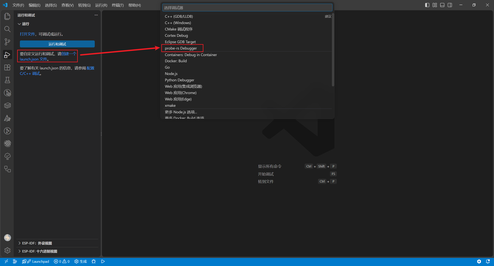
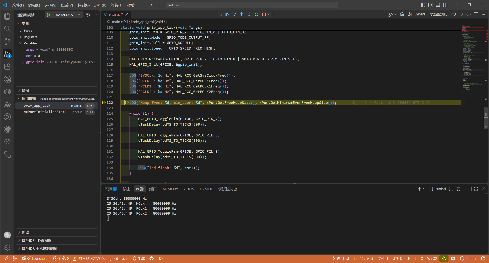

# 环境

- 开发板：ATK-STM32L4-Pandora v2.61

- 芯片：STM32L475VETx

- 编译器

  - arm-none-eabi-gcc（[Arm GNU Toolchain 15.3.Rel1](https://gitlab.arm.com/tooling/gnu-toolchains-for-arm/-/tree/releases/15.3.rel1)）
  - armclang（Arm Compiler for Embedded 6.19）

- CMake：[4.3.3](https://cmake.org/files/v4.3/)

- Python：[3.12.13](https://www.python.org/downloads/release/python-31213/)

- kconfiglib

  ```shell
  $ pip install kconfiglib
  ```

  当前安装的版本是 14.1.0（[Github 仓库](https://github.com/ulfalizer/Kconfiglib)）

# 使用

## 配置

```shell
$ cd project/led_flash
$ menuconfig
```

## 编译

```shell
$ cd project/led_flash
$ rm -rf build

# gcc
$ cmake -B build \
        -G Ninja \
        -DCMAKE_TOOLCHAIN_FILE=../../cmake/toolchain.cmake \
        -DTOOLCHAIN=gcc \
        -DTOOLCHAIN_BIN_DIR=xxx
$ cmake --build build

# armclang
$ cmake -B build \
        -G Ninja \
        -DCMAKE_TOOLCHAIN_FILE=../../cmake/toolchain.cmake \
        -DTOOLCHAIN=armclang \
        -DTOOLCHAIN_BIN_DIR=xxx
$ cmake --build build
```

注意：

1. 如果工具链路径已经加载到系统的 `PATH` 里面，则不需要添加 `TOOLCHAIN_BIN_DIR`。
1. 默认是 Debug 模式，如果要更改为 Release 模式，可以加上 `-DCMAKE_BUILD_TYPE=Release`。

## 打印信息

打印信息使用的是 SEGGER RTT 组件（开发板自带 ST-Link）。

### PyOCD

安装：

> 依赖 Python

```shell
# 安装 PyOCD
$ pip install pyocd

# 安装 Pack
$ pyocd pack install STM32L4

# 查找芯片对应的 Pack 名称
$ pyocd pack find STM32L4
  Part             Vendor               Pack                 Version   Installed
----------------------------------------------------------------------------------
  ...
  STM32L475VETx    STMicroelectronics   Keil.STM32L4xx_DFP   3.1.0     True
  ...
```

查看地址：

```shell
# gcc
$ arm-none-eabi-nm ./build/led_flash.elf | grep _SEGGER_RTT
200005e4 B _SEGGER_RTT

# armclang
$ fromelf --text -s ./build/led_flash.elf | grep _SEGGER_RTT
    586  _SEGGER_RTT                0x20000010   Gb    3  Data  Hi   0xa8
```

连接：

```shell
# 检测是否识别到 ST-Link
$ pyocd list
  #   Probe/Board    Unique ID                  Target
--------------------------------------------------------
  0   STM32 STLink   xxxxxxxxxxxxxxxxxxxxxxxx   n/a

# 连接 ST-Link
# -a 表示 --address, 手动指定 RTT 控制块在目标 MCU 内存中的地址
$ pyocd rtt -t STM32L475VETx -a 0x20000010
```

当前测试发现，使用 PyOCD 查看的话，输出打印信息的速度很慢。

### probe-rs

[Github 仓库](https://github.com/probe-rs/probe-rs)

安装：

```shell
# Windows
$ irm https://github.com/probe-rs/probe-rs/releases/latest/download/probe-rs-tools-installer.ps1 | iex

# Linux	/ MacOS
$ curl --proto '=https' --tlsv1.2 -LsSf https://github.com/probe-rs/probe-rs/releases/latest/download/probe-rs-tools-installer.sh | sh
```

连接：

```shell
# 连接到一个已经在运行的设备并查看 RTT 日志
$ probe-rs attach --chip STM32L475VETx --rtt-up-channels 0 ./build/led_flash.elf

# 烧录固件并查看 RTT 日志
$ probe-rs run --chip STM32L475VETx --rtt-up-channels 0 ./build/led_flash.elf
```

当前测试发现，使用 probe-rs 查看的话，输出打印信息的速度还行。

# 调试

## VSCode

### probe-rs

1. 在 VSCode 插件市场下载 `Debugger for probe-rs` 插件。

   [Github 仓库](https://github.com/probe-rs/vscode)

2. 使用 VSCode 打开具体某个项目目录，比如 `project/led_flash`。

   注意：不是打开 `ATK_STM32L4_Pandora` 这个目录。

3. 新建一个调试文件 `launch.json`。

   

   该文件的路径是 `project/led_flash/.vscode/launch.json`。

   简单的配置内容如下（详细的配置选项可以参考 [配置文档](https://probe.rs/docs/tools/debugger/)）：

   ```json
       "configurations": [
           {
               // 调试会话名称
               "name": "STM32L475VE Debug",
   
               // 调试器类型
               "type": "probe-rs-debug",
   
               // 请求类型
               // launch 表示启动新会话并烧录固件
               // attach 表示附加到已在运行的目标
               "request": "launch",
   
               // 芯片型号
               "chip": "STM32L475VETx",
   
               // 当前工作目录
               "cwd": "${workspaceFolder}",
   
               // 连接时保持复位状态, 确保在芯片复位后立即接管
               "connectUnderReset": false,
   
               // 烧录配置
               "flashingConfig": {
                   // 是否在调试前自动烧录固件
                   "flashingEnabled": true,
                   // 烧录前校验: 对比 Flash 内容与待烧录文件, 不一致才执行烧录
                   "verifyBeforeFlashing": true,
                   // 烧录后校验: 烧录完成后读回数据, 确认写入正确
                   "verifyAfterFlashing": true,
                   // 烧录完成后是否暂停 CPU (Reset_Handler)
                   "haltAfterReset": false
               },
   
               // 核心配置
               "coreConfigs": [
                   {
                       "coreIndex": 0,
                       // 程序文件路径
                       "programBinary": "${workspaceFolder}/build/led_flash.elf",
   
                       // 启用 RTT
                       "rttEnabled": true,
                       // 定义每个 RTT 通道的数据格式
                       "rttChannelFormats": [
                           {
                               // RTT 上行通道编号
                               "channelNumber": 0,
                               // 数据格式
                               // String 表示发送完整的文本
                               // Defmt 发送二进制编码的索引
                               "dataFormat": "String",
                               // 在每行 RTT 输出前加上主机端时间戳
                               "showTimestamps": true
                           }
                       ]
                   }
               ]
           }
       ]
   ```
   
4. 编译生成 .elf 文件后，就可以进行调试了。

   


当前每次修改代码后，都需要手动编译一次才能进行调试，比较麻烦。

这时候我们可以添加一个任务，用于在调试前自动编译一次。

> 注意：还是需要手动进行 cmake 配置的。

1. 新建一个任务文件 `task.json`。

   该文件的路径是 `project/led_flash/.vscode/task.json`。

   简单的配置内容如下：

   ```json
       "tasks": [
           {
               // 任务标签, 需要与 launch.json 中的 preLaunchTask 值一致
               "label": "STM32L475VE Build",
   
               // 通过系统 shell 执行命令
               "type": "shell",
   
               // 命令: cmake --build build
               "command": "cmake",
               "args": [
                   "--build",
                   "build"
               ],
   
               "options": {
                   // 任务执行的工作目录
                   "cwd": "${workspaceFolder}"
               }
           }
       ]
   ```

2. 在 `launch.json` 里添加该任务名称。

   ```json
       "configurations": [
           {
               ...
   
               // 调试前先执行 tasks.json 里 label 为 "STM32L475VE Build" 的任务
               "preLaunchTask": "STM32L475VE Build"
           }
       ]
   ```

   

