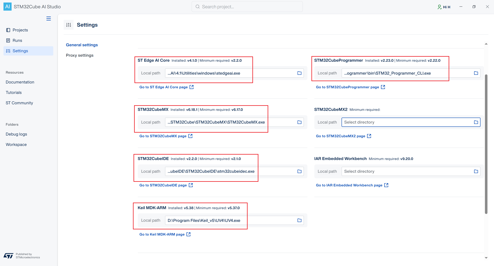
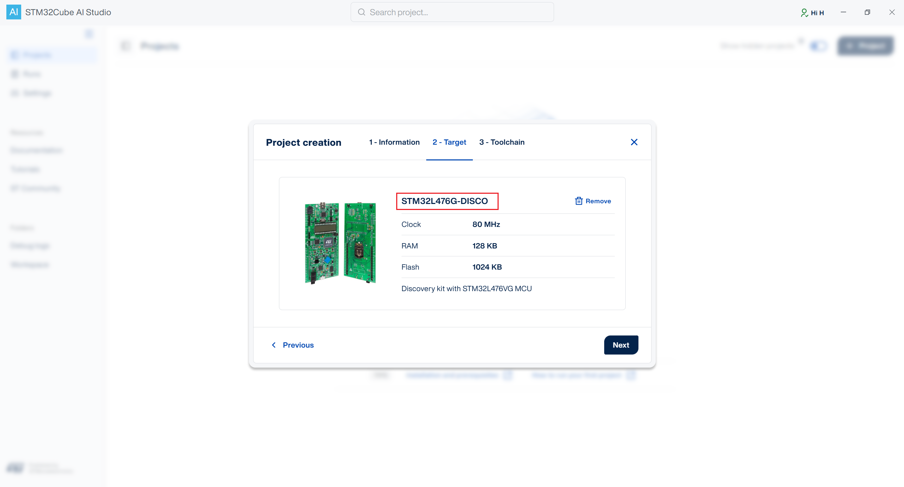
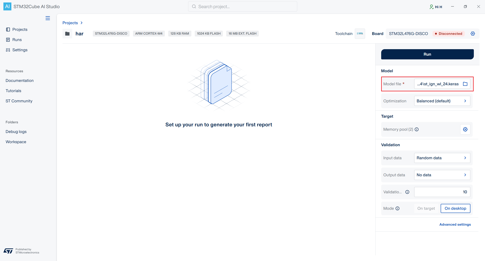
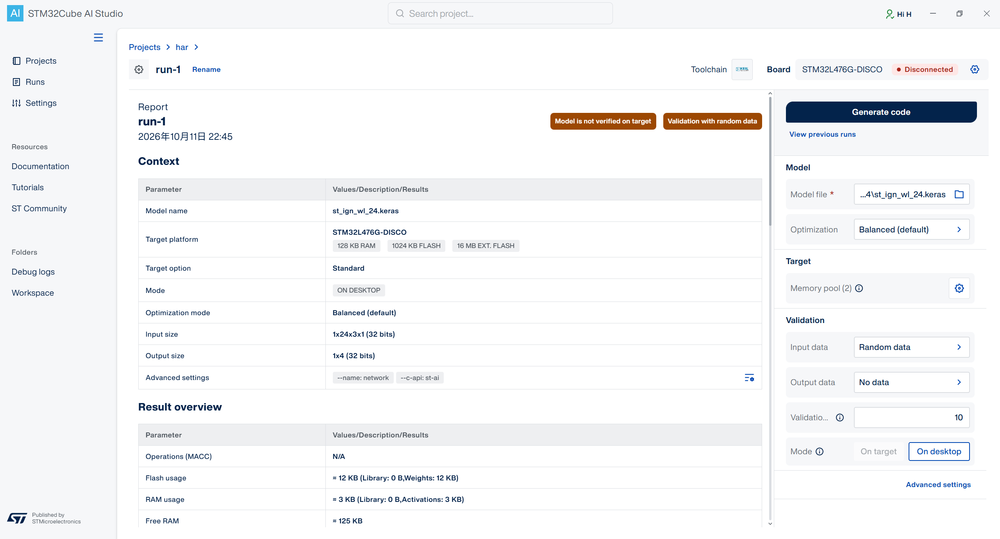

代码：

- [STM32 AI Model Zoo](https://github.com/STMicroelectronics/stm32ai-modelzoo) v4.1.0
- [STM32 AI Model Zoo Services](https://github.com/STMicroelectronics/stm32ai-modelzoo-services)

软件：STM32Cube AI Studio 1.3.0

# HAR

HAR，Human Activity Recognition，人体活动识别。

```shell
stm32ai-modelzoo
|- ...
|- human_activity_recognition
|  |- st_gmp
|  \- st_ign
\- ...
```

- st_gmp

  GMP，Global Max Pooling，全局最大池化。

  基于加速度计数据执行人体活动识别任务。

- st_ign

  IGN，Ignatov，指的是研究员 Andrey Ignatov。

  基于加速度计数据执行人体活动识别任务。

# 部署

这里以 st_ign 的部署为例。

## STM32 AI Model Zoo

### 目录结构

human_activity_recognition 的 st_ign 目录中存在以下文件：

```shell
st_ign
 |- ST_pretrainedmodel_custom_dataset
 |  |- mobility_v1
 |  |  |- st_ign_wl_24
 |  |  |  |- st_ign_wl_24.keras
 |  |  |  \- st_ign_wl_24_config.yaml
 |  |  |
 |  |  \- st_ign_wl_48
 |  |     |- st_ign_wl_48.keras
 |  |     \- st_ign_wl_48_config.yaml
 |  |
 |  \- ...
 |
 |- ST_pretrainedmodel_public_dataset
 |  |- WISDM
 |  |  |- st_ign_wl_24
 |  |  |  |- st_ign_wl_24.keras
 |  |  |  \- st_ign_wl_24_config.yaml
 |  |  |
 |  |  \- st_ign_wl_48
 |  |     |- st_ign_wl_48.keras
 |  |     \- st_ign_wl_48_config.yaml
 |  |
 |  \- ...
 |
 \- ...
```

- ST_pretrainedmodel_custom_dataset

  ST 使用自定义数据集训练的模型

- ST_pretrainedmodel_public_dataset

  ST 使用公开数据集训练的模型。

  > WISDM 是一个经典的人体活动识别公开数据集。


- wl_24

  Window Length = 24，即每次推理输入 24 个时间样本。

  > 24 个时间样本表示 24 组数据（x，y，z）。
  >
  > 如果加速度计的采样周期是 50Hz，那么 24 组数据耗时为 (1000ms / 50Hz) * 24 = 480ms。

- wl_48

  Window Length = 48，即每次推理输入 48 个时间样本。

WISDM 数据集的采样率是 20 Hz，mobility_v1 数据集的采样率是 26 Hz。

## STM32Cube AI Studio

> 当前使用的版本是 1.3.0

### 配置

当前的系统环境如下：

- Keil：5.38.0

  安装路径为 `D:\Program Files\Keil_v5`

- STM32CubeIDE：

  安装路径为：`D:\Program Files\STMicroelectronics\STM32CubeIDE`

- STM32CubeProgrammer：2.23.0

  安装路径为 `D:\Program Files\STMicroelectronics\STM32Cube\STM32CubeProgrammer`

- STM32CubeMX：6.18.1

  安装路径为 `D:\Program Files\STMicroelectronics\STM32Cube\STM32CubeMX`

- STEdgeAI：Core 4.1.0

  安装路径为 `D:\Program Files\STMicroelectronics\STEdgeAI`

  > 实际测试发现使用 Core 4.0.1 会报错




### 创建工程

创建一个名为 har 的工程：


开发板选择 STM32L476G-DISCO：



工具链选择 Makefile：


### 模型转换

这里的模型选用的是 `st_ign/ST_pretrainedmodel_custom_dataset/mobility_v1/st_ign_wl_24/st_ign_wl_24.keras`。



选择完成后，点击 `Run` 开始转换。

转换完成后如下所示：



### 生成代码

点击 `Generate code` 生成代码。


代码生成后，还需要下载到本地。


将下载的压缩包解压后，得到的目录结构是这样的：

```shell
.
├── AI
│   └── App
│       ├── app_config.h
│       ├── app_x-cube-ai.c
│       ├── app_x-cube-ai.h
│       ├── bsp_ai.h
│       ├── network_weights.c
│       ├── network_weights.h
│       ├── user_init.c
│       └── user_init.h
├── LICENSE.txt
├── Middlewares
│   └── ST
│       └── AI
│           ├── Inc
│           │   ├── ai_common_config.h
│           │   ├── ai_datatypes.h
│           │   ├── ai_datatypes_defines.h
│           │   ├── ai_datatypes_format.h
│           │   ├── ai_datatypes_internal.h
│           │   ├── ai_layer_custom_interface.h
│           │   ├── ai_lite.h
│           │   ├── ai_lite_inspect.h
│           │   ├── ai_lite_interface.h
│           │   ├── ai_lite_math_helpers.h
│           │   ├── ai_math_helpers.h
│           │   ├── ai_platform.h
│           │   ├── ai_platform_hsp.h
│           │   ├── ai_platform_interface.h
│           │   ├── core_assert.h
│           │   ├── core_common.h
│           │   ├── core_convert.h
│           │   ├── core_datatypes.h
│           │   ├── core_log.h
│           │   ├── core_net_inspect.h
│           │   ├── core_net_inspect_interface.h
│           │   ├── core_private.h
│           │   ├── datatypes_network.h
│           │   ├── formats_list.h
│           │   ├── layers.h
│           │   ├── layers_argminmax.h
│           │   ├── layers_avg_pool_grad.h
│           │   ├── layers_common.h
│           │   ├── layers_concat_split_training.h
│           │   ├── layers_conv2d.h
│           │   ├── layers_conv2d_dqnn.h
│           │   ├── layers_conv2d_odl.h
│           │   ├── layers_custom.h
│           │   ├── layers_dense.h
│           │   ├── layers_dense_dqnn.h
│           │   ├── layers_formats_converters.h
│           │   ├── layers_generic.h
│           │   ├── layers_generic_dqnn.h
│           │   ├── layers_in_place_accumulator.h
│           │   ├── layers_leaky_relu_grad.h
│           │   ├── layers_list.h
│           │   ├── layers_lite_graph.h
│           │   ├── layers_loss_softmax_crossentropy.h
│           │   ├── layers_loss_softmax_crossentropy_grad.h
│           │   ├── layers_max_pool_grad.h
│           │   ├── layers_ml.h
│           │   ├── layers_ml_iforest.h
│           │   ├── layers_ml_linearclassifier.h
│           │   ├── layers_ml_svc.h
│           │   ├── layers_ml_svmregressor.h
│           │   ├── layers_ml_treeensembleclassifier.h
│           │   ├── layers_ml_treeensembleregressor.h
│           │   ├── layers_nl.h
│           │   ├── layers_norm.h
│           │   ├── layers_pad_dqnn.h
│           │   ├── layers_pad_generic.h
│           │   ├── layers_pool.h
│           │   ├── layers_pool_dqnn.h
│           │   ├── layers_relu_grad.h
│           │   ├── layers_resize.h
│           │   ├── layers_rnn.h
│           │   ├── layers_sigmoid_grad.h
│           │   ├── layers_sm.h
│           │   ├── layers_tanh_grad.h
│           │   ├── layers_upsample.h
│           │   ├── layers_upsample_generic.h
│           │   ├── layers_wrappers.h
│           │   ├── lite_argminmax.h
│           │   ├── lite_bn_f32.h
│           │   ├── lite_bn_integer.h
│           │   ├── lite_conv2d.h
│           │   ├── lite_conv2d_dqnn.h
│           │   ├── lite_conv2d_is16.h
│           │   ├── lite_conv2d_sssa8_ch.h
│           │   ├── lite_convert_dqnn.h
│           │   ├── lite_convert_float16.h
│           │   ├── lite_dense_if32.h
│           │   ├── lite_dense_is1.h
│           │   ├── lite_dense_is16.h
│           │   ├── lite_dense_is1ws1.h
│           │   ├── lite_dense_is8os1ws1.h
│           │   ├── lite_dense_is8os8ws8.h
│           │   ├── lite_dense_ws1.h
│           │   ├── lite_dw.h
│           │   ├── lite_dw_dqnn.h
│           │   ├── lite_generic_float.h
│           │   ├── lite_gru_f16.h
│           │   ├── lite_gru_f32.h
│           │   ├── lite_internal_apis.h
│           │   ├── lite_lstm.h
│           │   ├── lite_maxpool_dqnn.h
│           │   ├── lite_nl_generic_integer.h
│           │   ├── lite_nl_list.h
│           │   ├── lite_norm_f32.h
│           │   ├── lite_operators.h
│           │   ├── lite_pad_dqnn.h
│           │   ├── lite_pad_generic.h
│           │   ├── lite_pool_f32.h
│           │   ├── lite_pool_is8os8.h
│           │   ├── lite_pw.h
│           │   ├── lite_pw_dqnn.h
│           │   ├── lite_resize.h
│           │   ├── lite_upsample.h
│           │   ├── lite_upsample_generic.h
│           │   ├── stai.h
│           │   ├── stai_debug.h
│           │   ├── stai_events.h
│           │   └── stai_ext.h
│           ├── Lib
│           │   └── NetworkRuntime1210_CM4_GCC.a
│           └── Misc
│               ├── Inc
│               │   ├── aiTestHelper.h
│               │   ├── aiTestHelper_ST_AI.h
│               │   ├── aiTestUtility.h
│               │   ├── ai_device_adaptor.h
│               │   └── lc_print.h
│               └── Src
│                   ├── aiTestHelper_ST_AI.c
│                   ├── aiTestUtility.c
│                   ├── ai_device_adaptor.c
│                   ├── lc_print.c
│                   └── syscalls.c
└── ai_generated_network
    ├── LICENSE.txt
    ├── network.c
    ├── network.h
    ├── network_data.c
    ├── network_data.h
    ├── network_details.h
    ├── network_generate_report.txt
    └── network_st_ign_wl_24_c_info_generate.json
```

要注意的是，`Middlewares\ST\AI\Lib` 目录下的 `.a` 库取决于你选择的工具链，前面使用的是 Makefile，所以这里是 `NetworkRuntime1210_CM4_GCC.a`。

## 代码适配

将生成的代码加入我们的项目工程里面。

- 修改点一：添加宏定义 `HAVE_NETWORK_INFO`

- 修改点二：不用包含 main.h

  ```c
  /* AI/App/bsp_ai.h */
  
  ...
  // #include "main.h"
  ...
  ```

- 修改点三：打印使用的 printf 函数由外部提供

  ```c
  /* Middlewares/ST/AI/Misc/Inc/ai_device_adaptor.h */
  
  #if !defined(_NO_DEVICE_PORT_FUNC)
  
  #if (defined(CORSTONE_320) || defined(CORSTONE_315) || defined(CORSTONE_310) || defined(CORSTONE_300) || defined(ARMCM55) || defined(ARMCM85)) && !defined(STM32N6) && !defined(STM32V8)
  ...
  #else
  
  #define DEVICE_FAMILY "STM32"
  
  #define USE_PRINTF_FROM_TOOL    1
  
  ...
  #endif
  
  #endif
  ```

- 修改点四：IO 重定向由外部提供

  ```c
  /* Middlewares/ST/AI/Misc/Inc/ai_device_adaptor.h */
  
  #if !defined(_NO_DEVICE_PORT_FUNC)
  
  #if (defined(CORSTONE_320) || defined(CORSTONE_315) || defined(CORSTONE_310) || defined(CORSTONE_300) || defined(ARMCM55) || defined(ARMCM85)) && !defined(STM32N6) && !defined(STM32V8)
  ...
  #else
  
  #define DEVICE_FAMILY "STM32"
  ...
  
  #define USE_RETARGET_IO_FROM_TOOL         1
  
  ...
  #endif
  
  #endif
  ```

- 修改点五：只使用 Systick 计时

  ```c
  /* Middlewares/ST/AI/Misc/Inc/ai_device_adaptor.h */
  
  #if !defined(_NO_DEVICE_PORT_FUNC)
  
  #if (defined(CORSTONE_320) || defined(CORSTONE_315) || defined(CORSTONE_310) || defined(CORSTONE_300) || defined(ARMCM55) || defined(ARMCM85)) && !defined(STM32N6) && !defined(STM32V8)
  ...
  #else
  
  #define DEVICE_FAMILY "STM32"
  ...
  
  #define HAS_PMU_CTRL                      0
  #if defined(STM32G0) || defined(STM32F0) || defined(STM32L0) || defined(STM32C0)
  #define HAS_DWT_CTRL                      0
  #else
  #define HAS_DWT_CTRL                      0
  #endif
  #define HAS_SYS_TICK                      1
  
  ...
  #endif
  
  #endif
  ```

- 修改点六：malloc 重定向由外部提供

  ```c
  /* Middlewares/ST/AI/Misc/Src/aiTestUtility.c */
  
  #if 0
  
  /* -----------------------------------------------------------------------------
   * HEAP Monitor functions
   * -----------------------------------------------------------------------------
   */
  
  #if defined(_IS_GCC_COMPILER) && _IS_GCC_COMPILER
  
  #define MAGIC_MALLOC_NUMBER 0xefdcba98
  
  ...
  #endif
  
  #endif
  ```

- 修改点七：获取加速度计数据（由 AI 生成）

  ```c
  /* AI/App/app_x-cube-ai.c */
  
  #include <math.h>
  
  int acquire_and_process_data()
  {
      #define WINDOWS_LENGTH 24
      #define ACCEL_NUM      3
  
      int16_t ax = 0;
      int16_t ay = 0;
      int16_t az = 0;
  
      float *in = (float *)stai_input[0];
  
      float window[WINDOWS_LENGTH][ACCEL_NUM];
  
      /* 采样 24 个点 */
      for (int i = 0; i < WINDOWS_LENGTH; i++) {
          extern int drv_icm20608_accelerometer_get(int16_t *x, int16_t *y, int16_t *z);
          drv_icm20608_accelerometer_get(&ax, &ay, &az);
  
          /* 加速度计 FSR = ±2g -> 16384 LSB/g */
          window[i][0] = (float)ax / 16384.0f;
          window[i][1] = (float)ay / 16384.0f;
          window[i][2] = (float)az / 16384.0f;
  
          /* 1000ms / 26 Hz ≈ 38.5 ms */
          HAL_Delay(38);
      }
  
      /* 计算窗口的平均重力向量 */
      float gx = 0.0f, gy = 0.0f, gz = 0.0f;
      for (int i = 0; i < WINDOWS_LENGTH; i++) {
          gx += window[i][0];
          gy += window[i][1];
          gz += window[i][2];
      }
      gx /= WINDOWS_LENGTH;
      gy /= WINDOWS_LENGTH;
      gz /= WINDOWS_LENGTH;
      float g_norm = sqrtf(gx * gx + gy * gy + gz * gz);
  
      /* 构造旋转矩阵 R (Rodrigues), 把重力向量对齐到 +Z 轴 */
      float R[3][3];
  
      if (g_norm > 0.1f) {
          float ux = gx / g_norm;
          float uy = gy / g_norm;
          float uz = gz / g_norm;
  
          /* 旋转轴 = 重力向量 × Z 轴 */
          float axis_x =  uy;
          float axis_y = -ux;
          float axis_z =  0.0f;
          float axis_norm = sqrtf(axis_x * axis_x + axis_y * axis_y);
  
          /* 旋转角 = 重力与 Z 轴夹角 */
          float angle = acosf(uz);
  
          if (axis_norm > 1e-6f) {
              axis_x /= axis_norm;
              axis_y /= axis_norm;
  
              float c = cosf(angle);
              float s = sinf(angle);
              float t = 1.0f - c;
  
              R[0][0] = t * axis_x * axis_x + c;
              R[0][1] = t * axis_x * axis_y - s * axis_z;
              R[0][2] = t * axis_x * axis_z + s * axis_y;
  
              R[1][0] = t * axis_x * axis_y + s * axis_z;
              R[1][1] = t * axis_y * axis_y + c;
              R[1][2] = t * axis_y * axis_z - s * axis_x;
  
              R[2][0] = t * axis_x * axis_z - s * axis_y;
              R[2][1] = t * axis_y * axis_z + s * axis_x;
              R[2][2] = t * axis_z * axis_z + c;
          } else {
              /* 重力已沿 ±Z, 退化为单位矩阵或 Z 翻转 */
              memset(R, 0, sizeof(R));
              R[0][0] = 1.0f;
              R[1][1] = 1.0f;
              R[2][2] = (uz > 0.0f) ? 1.0f : -1.0f;
          }
      } else {
          /* 重力接近 0 (自由落体或剧烈运动), 不旋转 */
          memset(R, 0, sizeof(R));
          R[0][0] = 1.0f;
          R[1][1] = 1.0f;
          R[2][2] = 1.0f;
      }
  
      /* 逐点旋转 + 重力抑制, 并写入 STAI 输入张量 */
      for (int i = 0; i < WINDOWS_LENGTH; i++) {
          float x = window[i][0];
          float y = window[i][1];
          float z = window[i][2];
  
          float rx = R[0][0] * x + R[0][1] * y + R[0][2] * z;
          float ry = R[1][0] * x + R[1][1] * y + R[1][2] * z;
          float rz = R[2][0] * x + R[2][1] * y + R[2][2] * z;
  
          in[i * ACCEL_NUM + 0] = rx;
          in[i * ACCEL_NUM + 1] = ry;
          in[i * ACCEL_NUM + 2] = rz - g_norm;   /* 减去重力分量 */
      }
  
      return 0;
  }
  ```

- 修改点八：输出结果（由 AI 生成）

  ```c
  /* AI/App/app_x-cube-ai.c */
  
  int post_process()
  {
      #define LABELS_NUM    4
      static const char *labels[LABELS_NUM] = {
          "Stationary", /* 静止 */
          "Walking",    /* 步行 */
          "Jogging",    /* 慢跑 */
          "Biking",     /* 骑行 */
      };
  
      const float *out = (const float *)stai_output[0];
  
      int best_class = 0;
      float best_conf = out[0];
  
      for (int i = 1; i < LABELS_NUM; i++) {
          if (out[i] > best_conf) {
              best_conf = out[i];
              best_class = i;
          }
      }
  
      printf("---- post_process ----\r\n");
      printf("Predicted: %s (conf=%.3f)\r\n", labels[best_class], best_conf);
      for (int i = 0; i < LABELS_NUM; i++) {
          printf("  %s: %.3f\r\n", labels[i], out[i]);
      }
  
      return 0;
  }
  ```

# 运行

## 编译

编译器要使用 GCC。

```shell
$ cd project/human_activity_recognition
$ rm -rf build

$ cmake -B build  -G Ninja -DCMAKE_TOOLCHAIN_FILE=../../cmake/toolchain.cmake -DTOOLCHAIN=gcc
$ cmake --build build
```

## 烧录

- 方法一：使用 STM32CubeProgrammer

- 方法二：使用 probe-rs

  ```shell
  $ probe-rs run --chip STM32L475VETx --rtt-up-channels 0 ./build/human_activity_recognition.elf
  ```

## 实测

1. 没有找到 ST 提供的数据案例，`acquire_and_process_data` 和 `post_process` 函数的内容是通过 AI 生成的。

2. 当前是顺序执行的：acquire_and_process_data -> aiRun -> post_process，其中：

   - acquire_and_process_data 采样 24 组数据
   - aiRun 处理数据，等待 5 秒钟
   - post_process 输出结果

   读取到的数据并不是实时数据。

```shell
...
16:13:12.343: ---- Inference number 11 ----
16:13:12.343: Results for network "network"
16:13:12.343: Running...
16:13:12.343:  duration DWT    : 4.758 ms
16:13:12.343:  duration SysTick: 5 ms
16:13:12.343:  CPU cycles      : 380689
16:13:12.343:  CPU cycles (avg): 380755
16:13:12.343:  Sleep for 5s...
16:13:17.305: ---- post_process ----
16:13:17.305: Predicted: Walking (conf=0.406)
16:13:17.305:   Stationary: 0.000
16:13:17.305:   Walking: 0.406
16:13:17.305:   Jogging: 0.286
16:13:17.305:   Biking: 0.308
16:13:18.342:  Timestamp    : SysTick only (1)
16:13:18.342: ---- Inference number 12 ----
16:13:18.342: Results for network "network"
16:13:18.342: Running...
16:13:18.342:  duration DWT    : 4.758 ms
16:13:18.342:  duration SysTick: 5 ms
16:13:18.342:  CPU cycles      : 380705
16:13:18.342:  CPU cycles (avg): 380751
16:13:18.342:  Sleep for 5s...
16:13:23.402: ---- post_process ----
16:13:23.402: Predicted: Biking (conf=0.768)
16:13:23.402:   Stationary: 0.000
16:13:23.402:   Walking: 0.072
16:13:23.402:   Jogging: 0.160
16:13:23.402:   Biking: 0.768
16:13:24.334:  Timestamp    : SysTick only (1)
16:13:24.334: ---- Inference number 13 ----
16:13:24.334: Results for network "network"
16:13:24.334: Running...
16:13:24.334:  duration DWT    : 4.758 ms
16:13:24.334:  duration SysTick: 5 ms
16:13:24.334:  CPU cycles      : 380684
16:13:24.334:  CPU cycles (avg): 380746
16:13:24.334:  Sleep for 5s...
16:13:29.395: ---- post_process ----
16:13:29.395: Predicted: Jogging (conf=0.483)
16:13:29.395:   Stationary: 0.001
16:13:29.395:   Walking: 0.126
16:13:29.395:   Jogging: 0.483
16:13:29.395:   Biking: 0.391
16:13:30.329:  Timestamp    : SysTick only (1)
...
```

